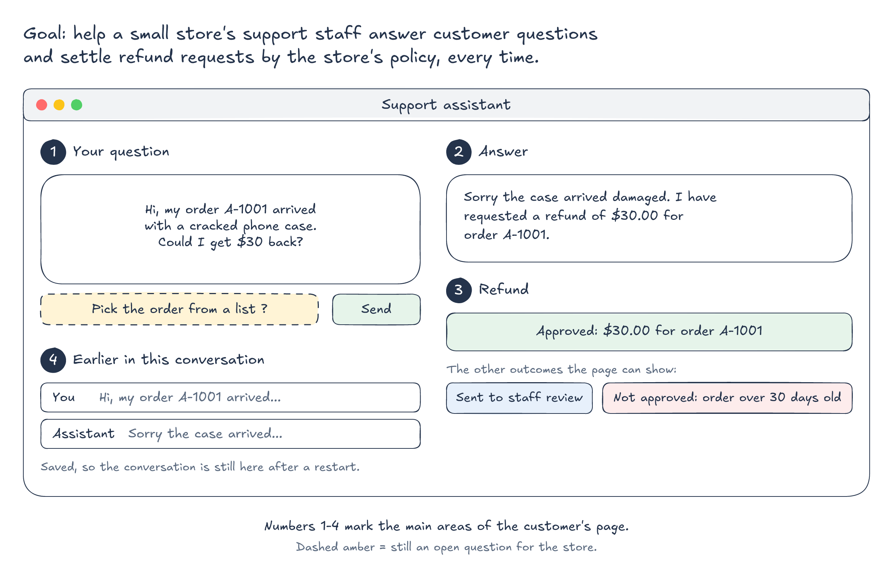
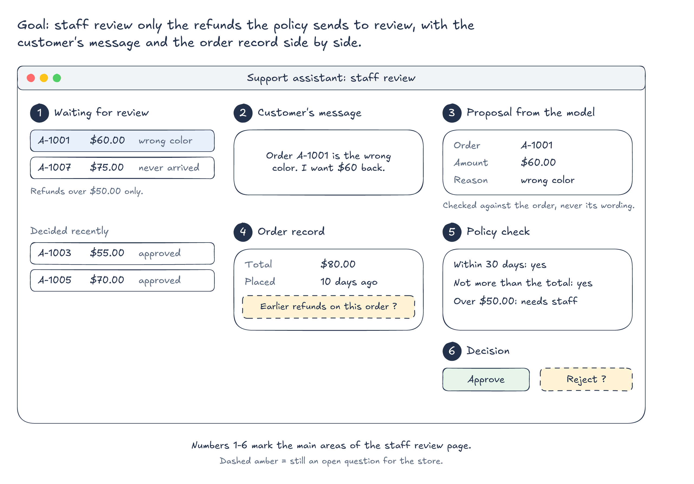
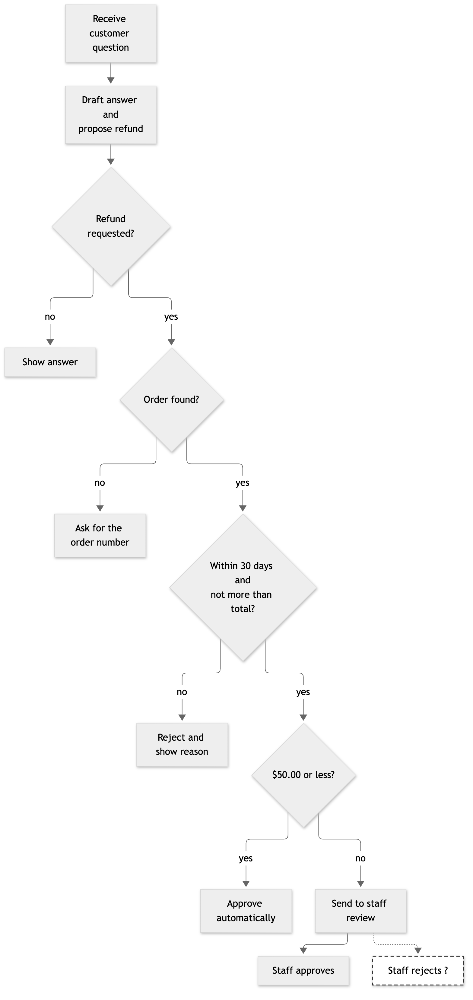
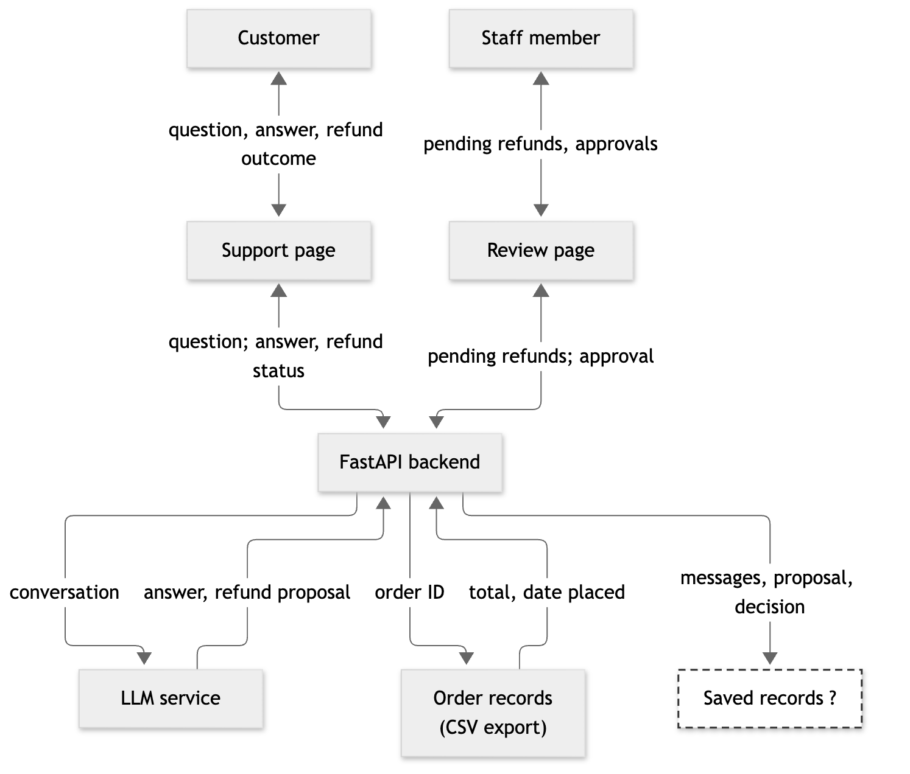
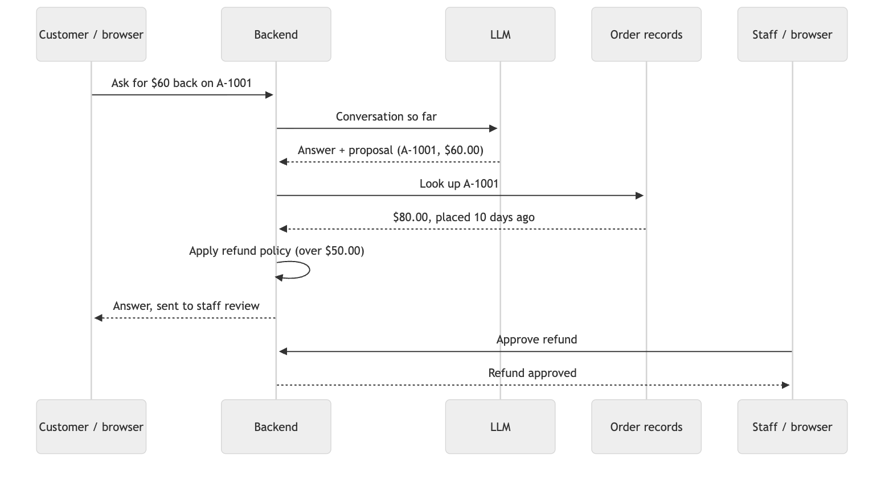
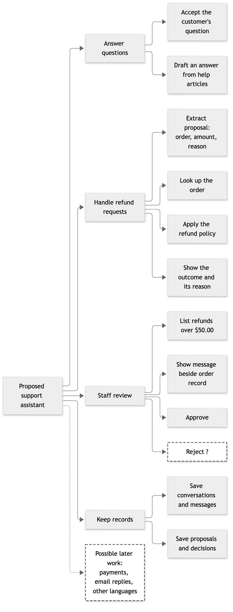

# Example Proposal: Support Assistant

This is a completed proposal worksheet for the course's running example, the
customer-support assistant used as the course's example project. It shows the level of
detail a proposal needs: one user, one workflow traced from input to result,
rules stated exactly enough to test, and open questions kept apart from
decisions. The store, its orders, and its customers are synthetic.

---

### Project Proposal Worksheet

**Project goal:** A support assistant that helps the support staff of a small
online store answer customer questions and handle refund requests consistently.

**Intended user and problem:** The store sells phone accessories and has two
part-time support staff. Customers write in through a form on the website, and
most messages are one of three kinds: a billing question, a technical question
about a product, or a request for a refund. Today a staff member reads each
message, looks up the order in a spreadsheet export, checks the refund policy by
hand, and writes a reply. Replies take up to a day, and two staff members apply
the refund policy differently: one approves small refunds on old orders and the
other does not.

The application has two users. A **customer** types a question and receives an
answer at once. A **staff member** reviews only the refund requests that the
policy does not settle automatically.

**Example input:**

```text
Hi, my order A-1001 arrived with a cracked phone case. Could I get $30 back?
```

**Sample input set:** Eight synthetic messages, written from the kinds of
messages the store receives, are listed below, each paired with
its expected result. All are synthetic; to check that they resemble real ones,
one staff member will read them and mark any that a customer would not write.

| # | Message (shortened) | Expected result |
|---|---|---|
| 1 | Order A-1001 arrived cracked, could I get $30 back? | Refund of $30.00 approved automatically |
| 2 | Order A-1001 is the wrong color, I want $60 back | Refund of $60.00 sent to staff review |
| 3 | Refund $90 for A-1001 please | Rejected: more than the order total of $80.00 |
| 4 | A-1002 stopped charging, refund the $20? | Rejected: the order is more than 30 days old |
| 5 | I was charged twice this month | Billing answer; no refund proposed |
| 6 | How do I reset my password? | Account answer; no refund proposed |
| 7 | Does the case fit the newer phone model? | Technical answer; no refund proposed |
| 8 | Refund my order | Answer asks for the order number; no refund proposed |

**Expected result and value:** The customer sees an answer to their question
and, for a refund request, one of three outcomes: approved, sent to staff
review, or rejected with the reason. The staff member sees a list of refunds
waiting for review, each with the customer's message and the order record.

The application improves the current work if refund decisions follow the policy
every time, and if staff spend their time only on the requests the policy sends
to review. Both can be observed: run the eight samples and compare each outcome
with the expected result, and count how many of a week's messages reach the
review list.

**Big-picture sketch:** The application has two pages, one for each user.
Numbered areas become the main blocks; dashed amber marks a question the store
has not answered yet.

<p align="center">
  
  <br>
  <em>The customer's page. The refund area shows one of three outcomes: approved, sent to staff review, or not approved with the reason.</em>
</p>

<p align="center">
  
  <br>
  <em>The staff member's page. The model's proposal sits beside the order record, so the decision is checked against the source data.</em>
</p>

**Workflow or component sketch:**

<p align="center">
  
  <br>
  <em>One proposed path from question to outcome. Each diamond is a decision; the dashed step still needs the store's answer.</em>
</p>

<details>
<summary>Mermaid code for this diagram</summary>

```
flowchart TD
    A["Receive customer question"] --> B["Draft answer and<br/>propose refund"]
    B --> C{"Refund<br/>requested?"}
    C -- no --> D["Show answer"]
    C -- yes --> E{"Order found?"}
    E -- no --> F["Ask for the order number"]
    E -- yes --> G{"Within 30 days and<br/>not more than total?"}
    G -- no --> R["Reject and show reason"]
    G -- yes --> H{"$50.00 or less?"}
    H -- yes --> I["Approve automatically"]
    H -- no --> J["Send to staff review"]
    J --> K["Staff approves"]
    J -.-> M["Staff rejects ?"]
    classDef open fill:#ffffff,stroke:#333333,stroke-width:1.5px,stroke-dasharray:6 4
    class M open
```

</details>

<p align="center">
  
  <br>
  <em>Each arrow is labeled with the information it carries. The dashed part has no chosen mechanism yet.</em>
</p>

<details>
<summary>Mermaid code for this diagram</summary>

```
flowchart TB
    C["Customer"] <-->|"question, answer, refund outcome"| UI["Support page"]
    S["Staff member"] <-->|"pending refunds, approvals"| RV["Review page"]
    UI <-->|"question; answer, refund status"| API["FastAPI backend"]
    RV <-->|"pending refunds; approval"| API
    API -->|"conversation"| LLM["LLM service"]
    LLM -->|"answer, refund proposal"| API
    API -->|"order ID"| ORD["Order records<br/>(CSV export)"]
    ORD -->|"total, date placed"| API
    API -->|"messages, proposal, decision"| DB["Saved records ?"]
    classDef open fill:#ffffff,stroke:#333333,stroke-width:1.5px,stroke-dasharray:6 4
    class DB open
```

</details>

<p align="center">
  
  <br>
  <em>One request that goes to staff review, read from top to bottom. Solid arrows are requests; dashed arrows are replies.</em>
</p>

<details>
<summary>Mermaid code for this diagram</summary>

```
sequenceDiagram
    participant C as Customer / browser
    participant B as Backend
    participant L as LLM
    participant O as Order records
    participant S as Staff / browser
    C->>B: Ask for $60 back on A-1001
    B->>L: Conversation so far
    L-->>B: Answer + proposal (A-1001, $60.00)
    B->>O: Look up A-1001
    O-->>B: $80.00, placed 10 days ago
    B->>B: Apply refund policy (over $50.00)
    B-->>C: Answer, sent to staff review
    S->>B: Approve refund
    B-->>S: Refund approved
```

</details>


**Data source and access:** Order records come from the store's order system,
exported as a CSV file with the order ID, the order total, and the date placed.
For this course the export is replaced by a synthetic file with the same
columns, so no customer names, addresses, or payment details are used. The
refund policy and the help articles come from the store's website, which is
public.

**Up to three core features:**

1. Answer a customer question, using the help articles where they apply.
2. Turn a refund request into a proposal and decide it with the refund policy,
   checked against the order record.
3. A review list where a staff member approves the refunds the policy sent to
   review.

<p align="center">
  
  <br>
  <em>The proposed first version grouped into features and responsibilities. Dashed boxes are open questions or later work.</em>
</p>

<details>
<summary>Mermaid code for this diagram</summary>

```
flowchart LR
    A["Proposed support assistant"] --> B["Answer questions"]
    A --> C["Handle refund requests"]
    A --> D["Staff review"]
    A --> E["Keep records"]
    A -.-> L["Possible later work:<br/>payments, email replies, other languages"]
    B --> B1["Accept the customer's question"]
    B --> B2["Draft an answer from help articles"]
    C --> C1["Extract proposal:<br/>order, amount, reason"]
    C --> C2["Look up the order"]
    C --> C3["Apply the refund policy"]
    C --> C4["Show the outcome and its reason"]
    D --> D1["List refunds over $50.00"]
    D --> D2["Show message beside order record"]
    D --> D3["Approve"]
    D --> D4["Reject ?"]
    E --> E1["Save conversations and messages"]
    E --> E2["Save proposals and decisions"]
    classDef open fill:#ffffff,stroke:#333333,stroke-width:1.5px,stroke-dasharray:6 4
    class D4,L open
```

</details>

**LLM role:** The model drafts the answer and, when the customer asks for money
back, extracts a refund proposal. Its input is the conversation so far. Its
output is a validated object: `answer` (text) and an optional `refund` with
`order_id`, `amount`, and `reason`. The model only proposes a refund; it never
decides one.

**Data use:** For each proposal, the application looks up the order by
`order_id` and compares the proposed amount with the order total and the
order's age.

**Saved records:**

- A **conversation**, with many **messages** (each question and its answer,
  with the model used, the tokens, and the cost).
- A **refund proposal**, which belongs to one conversation and one order.
- A **decision** for each proposal: approved, pending review, or rejected, with
  the reason and, for a reviewed refund, which staff member approved it.

All of these must remain available after a restart, because a refund sent to
review may be approved the next day.

**Searchable text:** Staff would search past conversations by meaning, for
example "customers who said the case does not fit", to find recurring product
problems. Help articles could also be searched to ground the answers.

**Human review:** Any refund over $50.00 needs a staff member's approval. The
review list shows the customer's message, the proposal, and the order record
side by side, so the staff member checks the proposal against the source data
rather than against the model's wording.

**One failure case:** A customer asks for $20.00 back on order A-1002, which was
placed 45 days ago. The policy rejects the proposal, and the page shows: "Your
refund request of $20.00 was not approved: the order is more than 30 days old."
No refund is approved, the order record is unchanged, and the rejected proposal
is saved with its reason.

**Three acceptance criteria (include at least one failure case):**

1. Given order A-1001 ($80.00, placed 10 days ago), when the customer asks for
   $30.00 back, then the refund is approved automatically and the page shows
   the approved amount.
2. Given the same order, when the customer asks for $60.00 back, then the
   proposal is sent to staff review and no refund is approved until a staff
   member approves it.
3. Given order A-1002 ($20.00, placed 45 days ago), when the customer asks for
   $20.00 back, then the proposal is rejected, the page shows that the order is
   more than 30 days old, and no refund is approved.

**Outside version one:** Customer accounts and sign-in; sending the refund to
the payment system (version one records an approved refund but moves no money);
replies by email; languages other than English; product returns and
replacements.

**Open questions:**

- *Decision to make:* Should a staff member be able to reject a refund from the
  review list, or only approve it? The store owner decides; ask before
  building feature 3.
- *Decision to make:* Should a conversation switch to a cheaper model after its
  cost reaches a budget? Decide after measuring what the sample conversations
  cost.
- *Learned later:* How the conversations and proposals are stored and searched
  is a technical detail for later in the semester. Version one keeps the
  sample orders in a small file in the code.

**Next investigation:** The biggest uncertainty is whether the model extracts
the right order ID and amount from messages written the way customers write
them. Run the eight sample messages through the agent and compare each proposal
with the expected result. If at least seven of eight are correct, keep the
design. If not, change the page so the customer chooses the order from a list,
and the model extracts only the amount and the reason.
